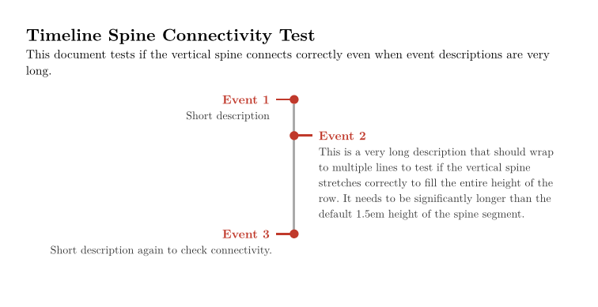
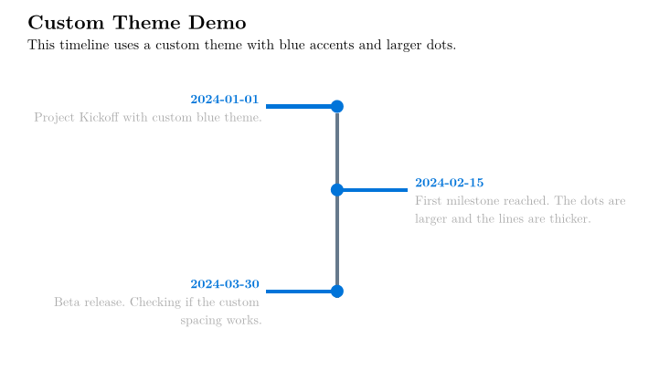

# Zeitline

A Typst package for plotting timelines.

## Examples





## Installation

Copy this package to your Typst packages directory or use it locally:

```typst
#import "@local/zeitline:0.1.0": timeline
```

Or import directly:

```typst
#import "lib.typ": timeline
```

## Usage

```typst
#import "lib.typ": timeline

#let events = (
  (date: "Jan 1", desc: "First event description"),
  (date: "Jan 2", desc: "Second event description"),
  (date: "Jan 3", desc: "Third event description"),
)

#timeline(events)
```

Each event is a dictionary with:
- `date`: The date/time label (required)
- `desc`: Event description (required)
- `side` (optional): Force "left" or "right" placement in two-sided mode (alternates by default)

## Timeline Layout (Single-Sided Mode)

By default, the timeline centers the spine and alternates events on both sides (`side: "both"`). You can create single-sided timelines so descriptions can span the full container width:

```typst
// Left spine with events on the right (full width)
#timeline(events, side: "left")

// Right spine with events on the left
#timeline(events, side: "right")
```

## Justification

You can control the text alignment of event descriptions using the justify argument. This is particularly useful for long descriptions to ensure they fill the row width cleanly while maintaining the vertical spine's connectivity.

```typst
// For ragged edges (default)
#timeline(events)

// For full justification
#timeline(events, justify: true)
```

## Theme Customization

```typst
#timeline(events, theme: (
  colors: (
    accent: rgb("#2980b9"),  // Blue instead of red
    muted: rgb("#555555"),
    line: rgb("#aaaaaa"),
  ),
  sizes: (
    date: 12pt,
    body: 10pt,
    dot: 6pt,
    line-width: 3pt,
  ),
  spacing: (
    row: 1.5em,
    arm: 3em,
  ),
))
```

## Running Tests

To run the tests (e.g., `repro.typ` or `custom_theme.typ`), you must run `typst compile` from the project root and specify the root path so that imports resolve correctly:

```bash
# Run from the project root
typst compile --root . tests/repro.typ
typst compile --root . tests/custom_theme.typ
```

## License

MIT
